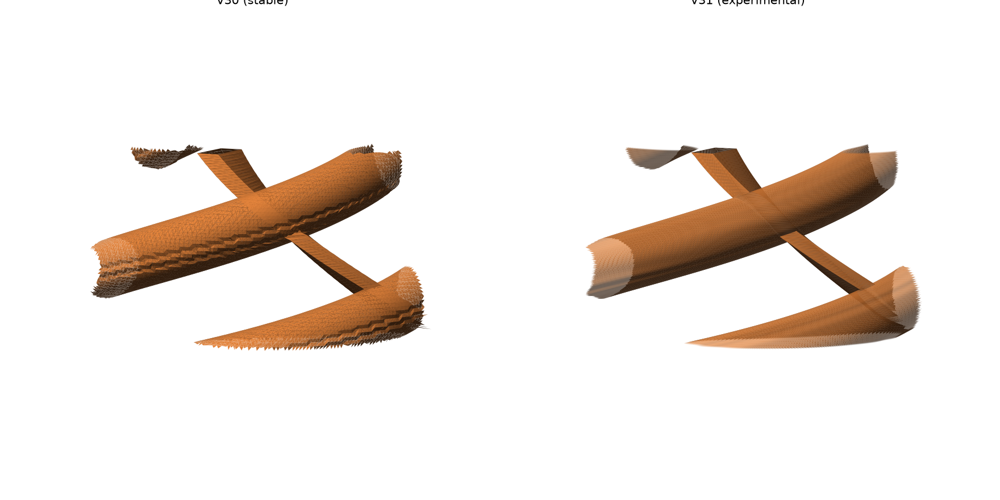
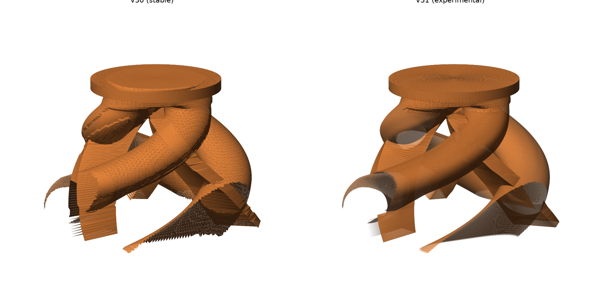

# TriFlex Test Log

This file separates physical observations from engineering hypotheses.

## V26 — physical test
Geometry:
- H35
- base Ø38
- top Ø9
- helix Ø3.3
- membrane 1.50 mm
- center-open underside

Observed:
- Excellent sensitivity.
- Tested successfully on 8-inch and 12-inch mesh pads.
- Strong hotspot directly over the cone.

Conclusion:
V26 established that the triple-helix/membrane architecture can achieve very high sensitivity, but hotspot control required further development.

## V29 — physical test / previous stable baseline (preserved control)
Geometry:
- H32
- base Ø38
- top Ø9
- helix Ø3.3
- membrane 1.30 mm
- membrane roots connected to base
- center-open underside
- 3 mm top allowance

Print record:
- STL: `models/stable/triflex-v29.stl` (5 closed, non-unioned shells)
- Sliced in Cura 5.2.1 with `cura/TriFlex_Ender3S1_TPU95A_V29_Validated.curaprofile` settings
- Build plate adhesion: none (no brim)
- G-code archived outside the repository (SHA-256 `76a47994a570abb57471f831934960b78eb8f7002983c95e7bb85267b698f32d`)

Observed:
- Excellent overall response.
- Hotspot substantially lower than the previous configuration.
- User assessment: best-performing cone tested in the project so far.

Important:
Several mechanical variables differ from V26, so the hotspot reduction cannot yet be assigned to one variable.

## V30 — current stable baseline
Geometry:
- Same as V29
- helix Ø3.1 instead of Ø3.3
- membrane remains 1.30 mm

Hypothesis:
Reducing arm diameter should soften the vertical spring response while preserving membrane-controlled lateral stability. A simple beam-style d^4 comparison suggests 3.1 mm arms have roughly 78% of the bending stiffness of 3.3 mm arms, but the actual TriFlex geometry is not a simple beam. This remains a design-direction estimate, not a measured complete-cone stiffness result.

### Initial physical test
Setup:
- Pad: 12-inch PD-128 BC
- Mesh head: original two-ply Roland mesh
- Module: Roland TD-9
- Top interface: self-adhesive furniture felt
- Module trigger settings: not yet recorded
- Test duration: not yet recorded

Observed (subjective user assessment):
- Excellent sensitivity.
- Excellent ghost-note response.
- Hotspot was substantially reduced.
- Print quality was good.

Not yet recorded:
- Controlled V29/V30 A/B comparison.
- Lateral-stability assessment.
- Print-to-print repeatability.
- Extended durability or cyclic-hit result.

Status at the time of the initial test:
- Initial physical test successful.
- V30 remained experimental pending repeatability and durability work.

Photographs: [V30 physical photo log](V30-PHOTO-LOG.md).

### Video demonstration

[Watch the V30 test on YouTube](https://www.youtube.com/watch?v=LNGkQPw1kC0).

The same performance is shown twice:
- 00:00 — Steven Slate Drums 5 (SSD5), triggered through TD-9 MIDI
- 00:58 — raw physical pad sound recorded by the camera microphone

Performance order:
1. 12-inch PD-128 BC
2. Custom DIY mesh pad
3. KD-85 kick pad

The original combined video is archived outside version control (SHA-256 `c93ed8d2d40ef7bc48ab52c7d52ae94c099c6ef5cd59a30ca403bda171156ca6`).

### Repeatability and durability test — 2026-10-05
Reported by the maintainer:
- Repeatability: multiple V30 prints were tested and behaved consistently.
- Durability: strike testing of up to approximately 10,000 hits.
- Result: passed.

Not separately recorded:
- Exact hit count per print, pads and module settings used during the durability run.
- Itemized post-test inspection (membrane-root cracking, helix fatigue, permanent set, top deformation).
- Before/after response comparison.

Decision:
- V30 promoted to the stable baseline.
- STL moved to `models/stable/triflex-v30.stl`, byte-for-byte identical to the tested file (SHA-256 `1380294200b95626e5e04df2e983cc174459755fc91b3e286d876464239f929f`). Like V29, it contains 5 closed, non-unioned shells; bounding box 38 × 38 × 32 mm.
- V29 is preserved unchanged as the previous stable control.

## V31 — generated experimental (not yet printed)
Change from V30:
- Surface quality only. The arm sawtooth seam and the stacked-slab membrane staircase of the V30 mesh are replaced by smooth lofts generated from V30's own horizontal sections (`cad/`). Base, cable notch, neck and top disc are taken unchanged from V30.
- No intended mechanical change.

Geometry check against V30 (`cad/compare_sections.py`, 160 layers at 0.2 mm):
- Volume: 4076.2 mm³ vs 4073.8 mm³ (+0.06%).
- Helix layers (z 3.0–29.5): mean section-area change +0.04%, max 0.99%; mean Hausdorff distance 0.086 mm, max 0.244 mm.
- Base, notch, neck and top layers: identical.
- Single closed, watertight solid; bounding box 38 × 38 × 32 mm.

Flat-shaded renders of the same crop, V30 left and V31 right:

File: `models/experimental/triflex-v31-experimental.stl` (SHA-256 `eb9c67e8ad07a56f6ba62ad608ad35d782ea5ea77b752520962588f391c975b7`).

Hypothesis:
Smoother arm and membrane surfaces should print with fewer bumps and a more uniform wall, without changing response. Not yet tested.

Required before any status change:
- Print with the reference Cura profile and inspect arm and membrane surfaces.
- A/B against a V30 printed from the same spool and settings: sensitivity, ghost notes, hotspot, lateral stability.
- If V31 behaves the same as V30, repeatability and durability checks as for V30.

## Planned durability work
Extended strike testing beyond 10,000 hits (for example 20,000 hits) with itemized inspection for membrane-root cracking, helix fatigue, permanent set, top deformation, and response drift.
