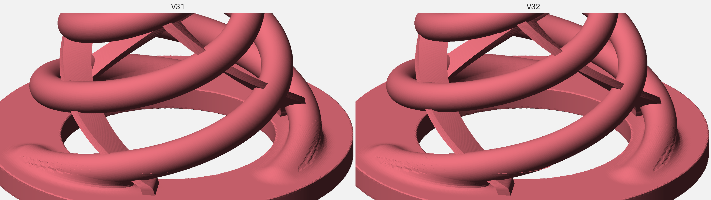
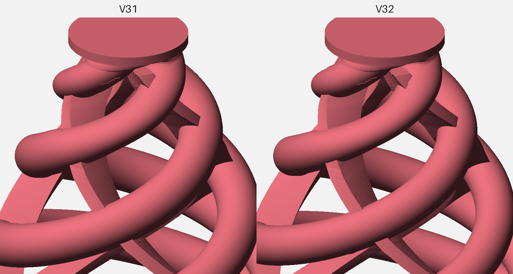

# TriFlex Test Log

This file separates physical observations from engineering hypotheses.

## V26 — physical test
Geometry:
- H35
- base Ø38
- top Ø9
- helix Ø3.3
- membrane 1.50 mm
- center-open underside

Observed:
- Excellent sensitivity.
- Tested successfully on 8-inch and 12-inch mesh pads.
- Strong hotspot directly over the cone.

Conclusion:
V26 established that the triple-helix/membrane architecture can achieve very high sensitivity, but hotspot control required further development.

## V29 — physical test / previous stable baseline (preserved control)
Geometry:
- H32
- base Ø38
- top Ø9
- helix Ø3.3
- membrane 1.30 mm
- membrane roots connected to base
- center-open underside
- 3 mm top allowance

Print record:
- STL: `models/stable/triflex-v29.stl` (5 closed, non-unioned shells)
- Sliced in Cura 5.2.1 with `cura/TriFlex_Ender3S1_TPU95A_V29_Validated.curaprofile` settings
- Build plate adhesion: none (no brim)
- G-code archived outside the repository (SHA-256 `76a47994a570abb57471f831934960b78eb8f7002983c95e7bb85267b698f32d`)

Observed:
- Excellent overall response.
- Hotspot substantially lower than the previous configuration.
- User assessment: best-performing cone tested in the project so far.

Important:
Several mechanical variables differ from V26, so the hotspot reduction cannot yet be assigned to one variable.

## V30 — current stable baseline
Geometry:
- Same as V29
- helix Ø3.1 instead of Ø3.3
- membrane remains 1.30 mm

Hypothesis:
Reducing arm diameter should soften the vertical spring response while preserving membrane-controlled lateral stability. A simple beam-style d^4 comparison suggests 3.1 mm arms have roughly 78% of the bending stiffness of 3.3 mm arms, but the actual TriFlex geometry is not a simple beam. This remains a design-direction estimate, not a measured complete-cone stiffness result.

### Initial physical test
Setup:
- Pad: 12-inch PD-128 BC
- Mesh head: original two-ply Roland mesh
- Module: Roland TD-9
- Top interface: self-adhesive furniture felt
- Module trigger settings: not yet recorded
- Test duration: not yet recorded

Observed (subjective user assessment):
- Excellent sensitivity.
- Excellent ghost-note response.
- Hotspot was substantially reduced.
- Print quality was good.

Not yet recorded:
- Controlled V29/V30 A/B comparison.
- Lateral-stability assessment.
- Print-to-print repeatability.
- Extended durability or cyclic-hit result.

Status at the time of the initial test:
- Initial physical test successful.
- V30 remained experimental pending repeatability and durability work.

Photographs: [V30 physical photo log](V30-PHOTO-LOG.md).

### Video demonstration

[Watch the V30 test on YouTube](https://www.youtube.com/watch?v=LNGkQPw1kC0).

The same performance is shown twice:
- 00:00 — Steven Slate Drums 5 (SSD5), triggered through TD-9 MIDI
- 00:58 — raw physical pad sound recorded by the camera microphone

Performance order:
1. 12-inch PD-128 BC
2. Custom DIY mesh pad
3. KD-85 kick pad

The original combined video is archived outside version control (SHA-256 `c93ed8d2d40ef7bc48ab52c7d52ae94c099c6ef5cd59a30ca403bda171156ca6`).

### Repeatability and durability test — 2026-10-05
Reported by the maintainer:
- Repeatability: multiple V30 prints were tested and behaved consistently.
- Durability: strike testing of up to approximately 10,000 hits.
- Result: passed.

Not separately recorded:
- Exact hit count per print, pads and module settings used during the durability run.
- Itemized post-test inspection (membrane-root cracking, helix fatigue, permanent set, top deformation).
- Before/after response comparison.

Decision:
- V30 promoted to the stable baseline.
- STL moved to `models/stable/triflex-v30.stl`, byte-for-byte identical to the tested file (SHA-256 `1380294200b95626e5e04df2e983cc174459755fc91b3e286d876464239f929f`). Like V29, it contains 5 closed, non-unioned shells; bounding box 38 × 38 × 32 mm.
- V29 is preserved unchanged as the previous stable control.

## V31 — generated experimental (printed, not yet functionally tested)
Change from V30:
- Surface quality only. The arm sawtooth seam and the stacked-slab membrane staircase of the V30 mesh are replaced by smooth geometry generated from V30 itself (`cad/`). Each arm is a tube swept along V30's arm centerline with V30's measured perpendicular section (circle of Ø3.29 mm, flattening to an ellipse of about 3.29 × 2.55 mm above z ≈ 24 mm), scaled to the same section area as V30. Membranes are lofted from V30's horizontal sections. Base with arm root fillets, cable notch, neck and top disc are taken unchanged from V30.
- No intended mechanical change.

Geometry check against V30 (`cad/compare_sections.py` with `cad/profiles/v31.json`, 160 layers at 0.2 mm):
- Volume: 4079.2 mm³ vs 4073.8 mm³ (+0.13%).
- Helix layers (z 3.0–29.5): mean section-area change +0.16%, max 1.52%; mean Hausdorff distance 0.071 mm, max 0.202 mm.
- Arm surface waviness (seam/groove depth in perpendicular sections, z 5.5–28.6): V30 median 67.5 µm peak-to-peak, V31 0.5 µm (mesh facets only).
- Base, notch, neck and top layers: identical.
- Single closed, watertight solid; bounding box 38 × 38 × 32 mm.

The first V31 build (SHA-256 `eb9c67e8…`) fitted each horizontal arm section with an order-8 Fourier curve. It turned the seam into lengthwise grooves (waviness 59.3 µm) instead of removing it, and was replaced before printing.

Flat-shaded renders of the same crop, V30 left and V31 right:

File: `models/experimental/triflex-v31-experimental.stl` (SHA-256 `4c81be7d1507448730b0600a13fc3b6006335c0be718009b19d561e1b6b4dd92`).

Hypothesis:
Smoother arm and membrane surfaces should print with fewer bumps and a more uniform wall, without changing response.

### Print 1 — surface quality (2026-10-06)
- File: the regenerated V31 above (SHA-256 `4c81be7d…`).
- Process: reference Cura profile `cura/TriFlex_Ender3S1_TPU95A_V29_Validated.curaprofile` unchanged; no supports, no brim.
- Result (visual assessment by the designer): very clean print; the designer rates the surface quality as the best reached so far and expects a better printer could improve it further.
- Not recorded: photos, dimensional measurements, print time, spool condition.
- No functional test yet: sensitivity, ghost notes, hotspot and lateral stability are untested, so the response half of the hypothesis is still open.

Required before any status change:
- ~~Print with the reference Cura profile and inspect arm and membrane surfaces.~~ Done (print 1, visual).
- A/B against a V30 printed from the same spool and settings: sensitivity, ghost notes, hotspot, lateral stability.
- If V31 behaves the same as V30, repeatability and durability checks as for V30.

## V32 — generated experimental (not yet printed)
Change from V31:
- Helix arm diameter only: Ø3.29 → Ø3.00 mm (section scale 0.912, applied to both ellipse axes, so the flattened top section shrinks in proportion). Generated by `cad/scale_arms.py cad/profiles/v31.json 3.0 cad/profiles/v32.json`.
- The scale blends in over 2.5 mm (cosine) at both ends of the swept tube, so the arm keeps V30/V31 thickness where it enters the root fillet and the neck: measured Ø3.31 at z = 5 (root), Ø3.00 at z = 8, Ø3.03 at z = 29 (neck).
- Centerline, membranes, base with root fillets, cable notch, neck and top disc unchanged from V31.

Geometry check against V31 (`cad/compare_sections.py` with `cad/profiles/v32.json`, 160 layers at 0.2 mm):
- Volume: 3832.5 mm³ vs 4079.2 mm³ (−6.0%).
- Helix layers (z 3.0–29.5): mean section-area change −11.87%, max 15.84%; mean Hausdorff distance 0.386 mm, max 0.601 mm.
- Base, notch, neck and top layers: identical.
- Arm surface waviness: 0.5 µm (same as V31).
- All arm–membrane crossings are kept; the overlap volume per crossing is about 10–15% smaller (for example 6.4–6.7 → 5.5–5.7 mm³). At six layers (z 8.3, 10.9, 13.3, 15.9, 23.1, 25.9) arm and membrane separate one layer earlier than in V31, so the slice shows 6 islands instead of 3; the parts stay connected in the layers above and below.
- Single closed, watertight solid; bounding box 38 × 38 × 32 mm. Profile and STL rebuild byte-for-byte.

Flat-shaded renders of the same crop, V31 left and V32 right:

File: `models/experimental/triflex-v32-experimental.stl` (SHA-256 `1a1ccf2bb3068117fb29de91926a4e548ac2b586d4709e33ae6693eb99fbac7d`).

Hypothesis (untested):
Arm bending stiffness scales with d⁴, so Ø3.0 arms should be about 69% as stiff as Ø3.29. A softer vertical response could improve ghost-note sensitivity and reduce hotspot further; the risks are lower lateral stability, faster permanent set and earlier fatigue at the arm roots.

Required before any status change:
- Print with the reference Cura profile; check arm surfaces and arm–membrane joints.
- A/B against V31 printed from the same spool and settings (V31 itself still needs its A/B against V30): sensitivity, ghost notes, hotspot, lateral stability.
- If V32 is better, repeatability and durability checks as for V30.

## V33 and V34 — generated experimental (not yet printed)
Built by the designer with the variant builder (`cad/variants/v33.toml`, `v34.toml`). Same change as V32 with a longer root/neck blend (3.0 mm instead of 2.5 mm):
- V33: arms Ø3.29 → Ø3.00 mm (SHA-256 `579b270a537f3211986efc53adb08bca7fd88a31a9cce1d52e039fa34dfb11af`).
- V34: arms Ø3.29 → Ø2.80 mm (SHA-256 `142b9283f48a9b1ab2cba07882f94ef9d307fa6a81dd6d77cc6ad02e218dcdb9`).
- Build checks passed (single closed solid, 38 × 38 × 32 mm); no further geometry check recorded.

## MiniFlex M04 — physically tested experimental (rim-side cylinder)
Separate product from the V30 center-cone line. Generated by `cad/generate_miniflex_cylinder.py`.

Geometry:
- Envelope Ø20 × H16 mm
- Arms Ø2.9 mm, opposite-wound membranes 1.90 mm
- Continuous base 2.8 mm with underside cable groove (1.0 mm bridge; not a through-cut)
- Center open Ø10 mm
- File: `models/experimental/triflex-miniflex-pdx8-m04-experimental.stl` (SHA-256 `d000a3a71cb1728bb07a8296421a1d3009342586cb8f6e3765731f15877c8f69`)

Setup (2026-10-17):
- Printed in TPU; installed on rim-side pad hardware (short cylinder envelope, edge loading)
- Photos: `assets/miniflex/`

Observed (subjective user assessment):
- Fit and mechanical response judged excellent for the intended short cylinder / rim-side use.
- Edge loading architecture: no center hotspot to chase (by design, not a V30 A/B result).
- Continuous thicker base with underside groove fixed the earlier through-notch splay issue (M03).

Status:
- Physically tested experimental — promising first functional press test.
- Not a stable baseline; longer durability and multi-print repeatability not yet recorded.
- Do not describe as a drop-in replacement for the V30 center-cone family.

## Planned durability work
Extended strike testing beyond 10,000 hits (for example 20,000 hits) with itemized inspection for membrane-root cracking, helix fatigue, permanent set, top deformation, and response drift.
